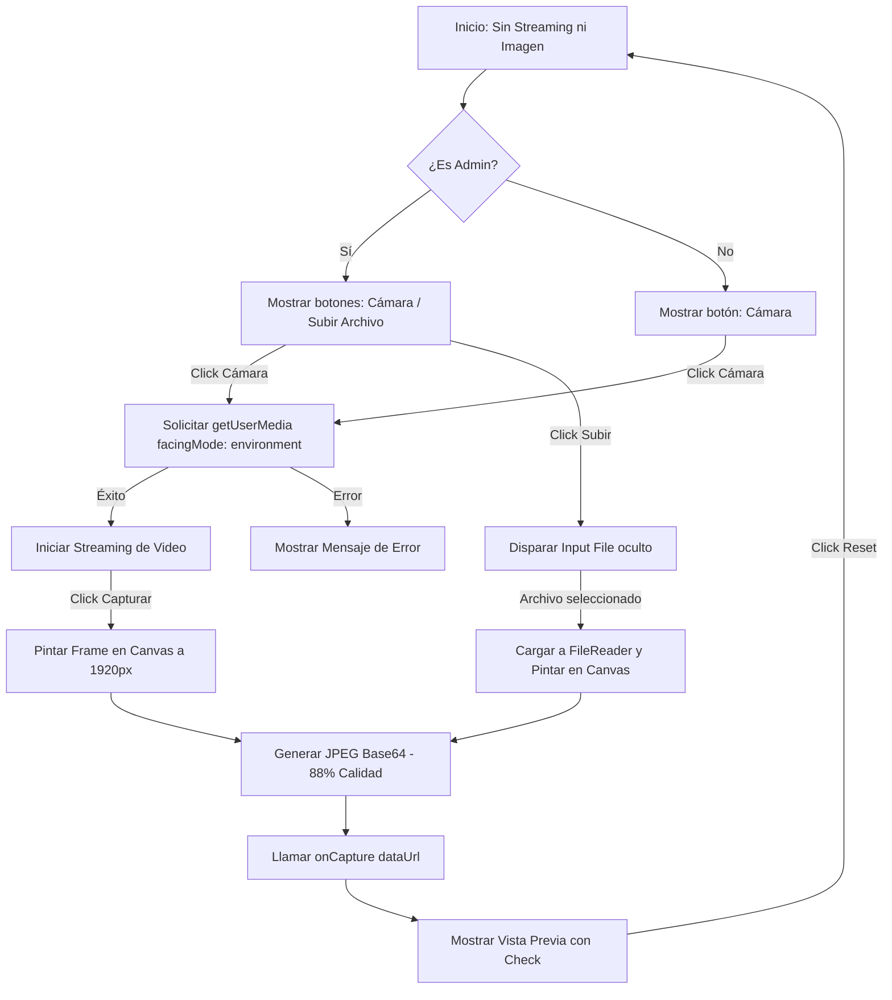
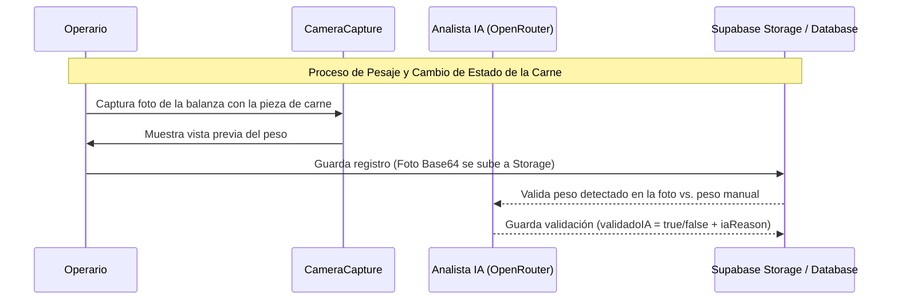

# Documentación del Módulo CameraCapture (`CameraCapture.tsx`)

Este documento describe en detalle el funcionamiento técnico, la integración con el modelo de negocio de trazabilidad de carnes y el esquema de base de datos correspondiente al componente de captura fotográfica del sistema.

---

## 1. Descripción Técnica

El componente [CameraCapture](file:///c:/Users/Comanda/apps/carnestrace---meat-traceability-system-bookcafe/src/components/CameraCapture.tsx) es un módulo modular e interactivo en React diseñado para capturar imágenes directamente desde la cámara del dispositivo (optimizado para dispositivos móviles) o permitir la subida manual de imágenes.

### Características Clave
- **Acceso Directo al Hardware**: Utiliza la API `navigator.mediaDevices.getUserMedia` para interactuar con la cámara.
- **Optimización de Cámara Móvil**: Intenta priorizar la cámara trasera (`facingMode: "environment"`) en smartphones para facilitar el registro de lecturas en básculas o estado físico del producto. Si no está disponible, realiza un fallback a la cámara frontal o predeterminada.
- **Procesamiento de Imagen Local**: Usa un elemento `<canvas>` oculto para reescalar la imagen de manera dinámica hasta un ancho máximo de **1920px** preservando el aspecto nativo. Esto asegura la nitidez óptima para análisis posterior mediante IA (OCR / Verificación) al mismo tiempo que reduce el peso del archivo mediante compresión JPEG al **88%** de calidad.
- **Subida de Archivo Alternativa**: Permite la carga de archivos locales si el usuario es administrador (`isAdmin = true`) o si hay fallos con la cámara.

### Flujo Técnico del Componente



### Propiedades (Props)

El componente expone la siguiente interfaz:

```typescript
interface CameraCaptureProps {
  onCapture: (image: string) => void; // Callback que retorna la imagen codificada en Base64
  isAdmin?: boolean;                  // Si es verdadero, habilita la opción de subir archivo local
  className?: string;                 // Clases CSS adicionales (usando Tailwind)
}
```

---

## 2. Modelo de Negocio y Proceso de Trazabilidad

En la trazabilidad de carnes, **la precisión de los datos y el control de mermas** son fundamentales para garantizar la rentabilidad, frescura e inocuidad del producto. El componente `CameraCapture` actúa como el **sensor o punto de entrada de evidencia física digitalizada**.

El flujo de trazabilidad de la aplicación consta de transiciones críticas de estado en las cuales el pesaje verificado es crucial:



### Casos de Uso del Componente en el Negocio

1. **Evidencia de Pesos en Transiciones de Estado** (`App.tsx`):
   Cada vez que una pieza de carne cambia de estado (de *CREADA* $\rightarrow$ *CONGELADA* $\rightarrow$ *DESCONGELADA* $\rightarrow$ *PRODUCIDA*), el operario de cocina debe registrar el peso actual. La cámara captura la pantalla de la báscula para que una Inteligencia Artificial verifique de manera automática que el peso ingresado coincide con el de la foto.
2. **Registro de Mermas**:
   Permite documentar visualmente si una pieza presenta un desperdicio o merma inusual (mermas por descongelación o limpieza), permitiendo auditorías posteriores por parte del Administrador o Analista.
3. **Evidencia en Transferencias** (`TransferenciasView.tsx`):
   Al transferir productos entre diferentes sedes (ej. Almacén Principal $\rightarrow$ Cocina), se captura una imagen del lote o del remito firmado como comprobante físico digitalizado del traspaso.
4. **Registro de Producción** (`ProduccionView.tsx`):
   Evidencia visual del lote producido listo para la venta o almacenamiento.

---

## 3. Esquema de Base de Datos y Almacenamiento

Las imágenes capturadas por `CameraCapture` se transmiten en Base64 al backend, donde se procesan y almacenan en un bucket de **Supabase Storage**, registrando las URLs resultantes en las tablas correspondientes de PostgreSQL.

### Almacenamiento (Buckets)
- **Bucket**: `evidencias`
- **Ruta de archivo**: `${fileName}.jpg` (usualmente nombrado usando el ID del registro o de la pieza).

### Esquema de Tablas Relacionadas (PostgreSQL)

#### 1. Tabla `registros_peso`
Registra cada uno de los eventos de pesaje y las validaciones de IA asociadas.

| Campo | Tipo SQL | Descripción |
| :--- | :--- | :--- |
| `id` | `UUID` (PK) | Identificador único del registro de peso. |
| `pieza_id` | `VARCHAR` (FK) | Relación con la tabla `piezas`. |
| `tipo_evento` | `VARCHAR` | Tipo de pesaje (`CONGELADO`, `DESCONGELADO`, `PRODUCIDO`, `CARGADO`). |
| `peso` | `NUMERIC` | Peso ingresado manualmente por el usuario. |
| `foto_url` | `VARCHAR` | **URL pública de la imagen de evidencia capturada por la cámara** (almacenada en el bucket `evidencias`). |
| `foto_merma_url` | `VARCHAR` | **URL de la imagen de evidencia de merma** (si aplica). |
| `usuario_nombre` | `VARCHAR` | Nombre del operario que realizó la captura. |
| `validado_ia` | `BOOLEAN` | Indica si la IA validó correctamente el peso basándose en la imagen. |
| `ia_detected_weight`| `NUMERIC` | Peso que la IA detectó leyendo la imagen. |
| `ia_reason` | `TEXT` | Razón o justificación del análisis de la IA en caso de discrepancias. |
| `fecha` | `TIMESTAMP` | Fecha y hora en que se creó el registro. |

#### 2. Tabla `piezas`
Mantiene la información consolidada de cada corte/pieza de carne a lo largo de su ciclo de vida.

| Campo | Tipo SQL | Descripción |
| :--- | :--- | :--- |
| `id` | `VARCHAR` (PK) | Identificador único de la pieza (código de barras/QR). |
| `tipo` | `VARCHAR` | Nombre del corte (ej. Lomo Fino, Ribeye). |
| `estado` | `VARCHAR` | Estado actual de la pieza (`CREADA`, `CONGELADA`, `DESCONGELADA`, `PRODUCIDA`, `CARGADO EN SISTEMA`). |
| `peso_congelado` | `NUMERIC` | Peso registrado en estado congelado. |
| `peso_descongelado` | `NUMERIC` | Peso registrado en estado descongelado. |
| `peso_producido` | `NUMERIC` | Peso registrado en estado de producto final. |
| `foto_merma_url` | `VARCHAR` | **URL de la foto de merma consolidada** tomada en el proceso. |
| `merma_descongelado`| `NUMERIC` | % de merma en el proceso de descongelación. |
| `merma_total` | `NUMERIC` | % de merma total del ciclo. |
| `rendimiento` | `NUMERIC` | % de rendimiento final. |
| `porciones` | `JSONB` | Array con el desglose de porciones obtenidas (`pesoGramos`, `cantidad`). |
| `created_at` | `TIMESTAMP` | Fecha de creación. |
| `updated_at` | `TIMESTAMP` | Fecha de última actualización. |
| `auditado` | `BOOLEAN` | Indica si el registro fue auditado manualmente por un administrador. |
| `comentario_auditoria`| `TEXT` | Comentarios del auditor. |
| `analisis_ia` | `TEXT` | Resumen detallado del análisis global de trazabilidad por IA. |

#### 3. Tabla `transferencias`
Registra los movimientos de inventario inter-sedes.

| Campo | Tipo SQL | Descripción |
| :--- | :--- | :--- |
| `id` | `VARCHAR` (PK) | Identificador único de la transferencia. |
| `sede_origen` | `VARCHAR` | Sede desde donde sale la mercancía. |
| `sede_destino` | `VARCHAR` | Sede receptora de la mercancía. |
| `productos` | `JSONB` | Listado de productos transferidos (nombre, cantidad, unidad). |
| `foto_url` | `VARCHAR` | **URL de la foto del remito o mercancía física** capturada en el envío. |
| `usuario` | `VARCHAR` | Nombre del usuario que despacha. |
| `fecha` | `TIMESTAMP` | Fecha de la transferencia. |
| `status` | `BOOLEAN` | Estado de aceptación/recepción. |
